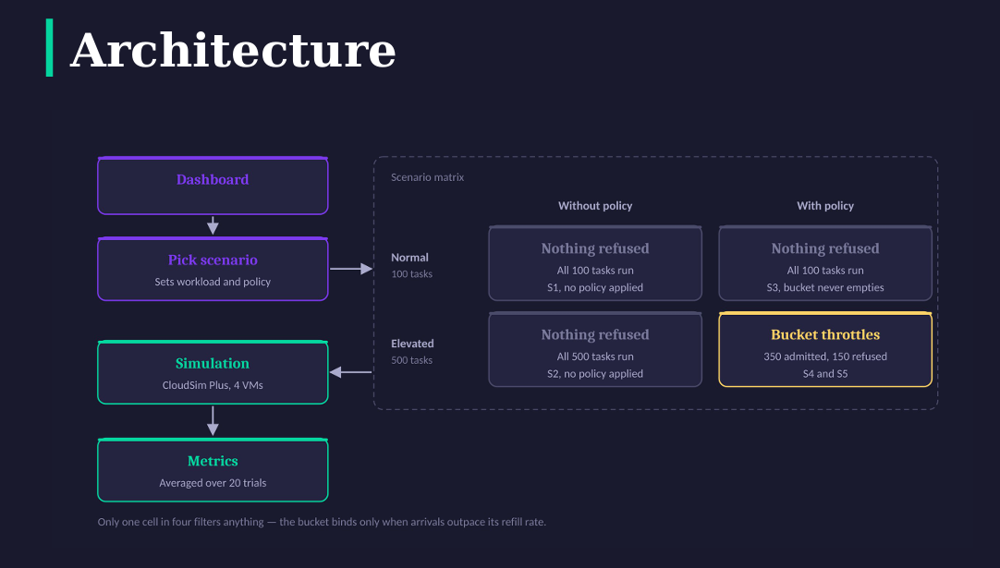
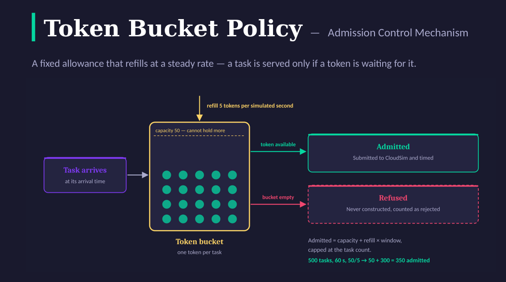

<div align="center">

# CloudGuard

### Performance Evaluation of Cloud Services Under Simulated DoS Workloads

[](https://openjdk.org)
[](https://spring.io/projects/spring-boot)
[](https://cloudsimplus.org)
[](https://www.h2database.com)
[](https://www.docker.com)

Cloud Security course project · M.Tech Cybersecurity · IIIT Sri City

</div>

> **Simulation only.** CloudGuard models computational tasks (Cloudlets) and admission control in CloudSim Plus. No real HTTP requests, packets or network traffic are generated at any point. Completion time is the simulated Cloudlet *finish − arrival* time, not network latency.

---

## Overview

CloudGuard measures how a cloud service behaves under normal and elevated task-arrival pressure, and how a **Token Bucket admission policy** changes that behaviour. A Spring Boot backend drives a CloudSim Plus simulation; a browser dashboard runs the scenarios and renders the analytics.

Under the elevated workload, the policy cuts average completion time by **30.7%** (611.9 s → 424.2 s) and pays for it by refusing **30%** of the workload (150 of 500 tasks). Under the normal workload it changes nothing.

## Objectives

1. **Generate the workloads** — normal and elevated synthetic request workloads, evenly spaced across a 60-second window.
2. **Compare before and after** — service performance with and without a workload-admission (throttling) policy.
3. **Demonstrate the trade-off** — task completion time against the percentage of workload rejected.

---

## Architecture



The scenario chosen in the dashboard fixes two things — the workload and whether the policy is applied — which places the run in one cell of the scenario matrix. The simulation then runs on CloudSim Plus and the metrics are averaged over 20 trials.

<details>
<summary><b>Component view</b></summary>
<br/>


</details>

---

## Token Bucket Admission Policy



A fixed allowance that refills at a steady rate. A task is served only if a token is waiting for it.

| Property | Behaviour |
|---|---|
| Capacity | 50 tokens — the bucket starts full and cannot hold more |
| Refill | 5 tokens per simulated second |
| Cost | One token per task, checked at the task's arrival time |
| Token available | Task is **admitted** — submitted to CloudSim Plus and timed |
| Bucket empty | Task is **refused** — never constructed, counted as rejected |

Under saturated demand the number of admitted tasks has a closed form:

```
admitted = min(tasks, capacity + refill × window)

Elevated:  min(500, 50 + 5 × 60) = 350 admitted, 150 refused
Normal:    arrivals (1.7/s) stay below the refill rate (5/s), so nothing is refused
```

---

## Experiment Design

Runs with and without the policy differ **only** in that policy — never in workload, infrastructure, trials or seed.

| Scenario | Workload | Tasks | Admission policy | Purpose |
|:---:|---|:---:|:---:|---|
| **S1** | Normal | 100 | Off | Baseline, normal workload |
| **S2** | Elevated | 500 | Off | Baseline, elevated workload |
| **S3** | Normal | 100 | On | Policy under normal workload |
| **S4** | Elevated | 500 | On | Policy under elevated workload |
| **S5** | Elevated | 500 each | On | Threshold sweep: `25/2`, `50/5`, `100/10` (capacity / refill) |

| | Configuration |
|---|---|
| **Infrastructure** | 2 hosts × 4 PEs @ 2000 MIPS · 4 VMs (1 PE each) · SpaceShared scheduler, so at most 4 tasks run concurrently |
| **Workload** | Arrivals evenly spaced over a 60 s window — 1.7 tasks/s normal, 8.3 tasks/s elevated (five times the density) |
| **Execution** | 20 trials per scenario · seeds 42–61, all unique · mean and 95% confidence interval reported |

The seed varies task length by ±10% only, never arrival times, so admitted and rejected counts are identical across trials. The full verified baseline is in [RESEARCH_CONFIGURATION.md](docs/RESEARCH_CONFIGURATION.md).

---

## Results

| Workload | Before policy | After policy | Change | Workload rejected |
|---|:---:|:---:|:---:|:---:|
| **Normal** (S1 vs S3) | 103.6 s | 103.6 s | None | 0% (0 of 100) |
| **Elevated** (S2 vs S4) | 611.9 s | 424.2 s | **30.7% faster** | **30%** (150 of 500) |

*Average task completion time, mean of 20 trials.*

**Conclusions**

1. **The policy improves service under pressure.** Average completion time fell 30.7% under the elevated workload.
2. **It does so by refusing work.** 150 of 500 tasks received no service at all; the 424.2 s average covers only the tasks that were served. Admission control sheds workload — it does not add capacity.
3. **It does nothing when it is not needed.** Under the normal workload the bucket never empties, so nothing changes.

---

## Dashboard

| | |
|:---:|:---:|
|  |  |
| **Overview** — latest-run KPIs and scenarios | **Results & analytics** — S4: 500 → 350 admitted, 150 rejected |
|  |  |
| **Scenario manager** — run S1–S5 | **Experiment history** — saved runs and CSV export |

The dashboard has seven sections: Overview, Infrastructure, Workload studio, Security policy, Scenario manager, Results & analytics, and Experiment history.

---

## Technology Stack

| Layer | Technology | Details |
|---|---|---|
| **Simulation engine** | CloudSim Plus 8.5.7 | SpaceShared cloudlet scheduler · 2 hosts × 4 PEs · 4 VMs @ 2000 MIPS |
| **Application** | Java 17 · Spring Boot 3.4.5 | REST API with eight endpoints · Maven build |
| **Persistence** | H2 file-backed database | Requests and results stored as JSON · per-task CSV export |
| **Interface** | Vanilla JavaScript | HTML and CSS, no framework · SVG charts |

Everything runs locally on a single machine. No external services are contacted.

---

## Getting Started

```bash
git clone https://github.com/akhilsabu-iiits/CloudGuard.git
cd CloudGuard
```

**Option A — Maven** (requires Java 17 and Maven)

```bash
mvn spring-boot:run                           # start on http://localhost:8080
mvn clean package && java -jar target/*.jar   # or build and run a jar
mvn test                                      # run the tests
```

**Option B — Docker** (requires [Docker Desktop](https://www.docker.com/products/docker-desktop/) or [Docker Engine](https://docs.docker.com/engine/install/))

```bash
docker compose up --build -d     # build and start in the background
docker compose logs -f           # follow the logs
docker compose down              # stop (the cloudguard-data volume is kept)
```

The dashboard is served at **http://localhost:8080**. With Docker, H2 data persists in the `cloudguard-data` volume (`/app/data`), so experiment history survives restarts. See [DEPLOYMENT.md](DEPLOYMENT.md) for deployment details.

---

## API

| Method | Endpoint | Description |
|---|---|---|
| `GET` | `/api/health` | Service and simulation-engine status |
| `GET` | `/api/scenarios` | Scenario catalogue (S1–S5) |
| `POST` | `/api/experiments/run` | Run one scenario |
| `POST` | `/api/experiments/suite` | Run the full S1–S5 suite |
| `GET` | `/api/experiments` | Experiment history (latest 50) |
| `GET` | `/api/experiments/{id}` | Full result of one experiment |
| `GET` | `/api/experiments/{id}/export.csv` | Per-task CSV export |
| `POST` | `/api/experiments/reset` | Delete all experiment records — loopback only, requires a confirmation phrase |

---

## Scope and Limitations

- **Simulation, not real DoS/DDoS.** "DoS workload" means elevated computational task arrivals inside CloudSim Plus; nothing is sent over a network.
- **Simulated completion time.** Cloudlet finish − arrival, not real latency or availability.
- **Deterministic, evenly spaced arrivals.** Bursty or adversarial arrival patterns are not modelled.
- **Local research tool.** Single-node H2 and no authentication; not intended for public multi-user deployment.

---

## Team

**Group 4** — M.Tech Cybersecurity, IIIT Sri City

| Name | Roll number |
|---|---|
| Akhil Sabu | OMCS25S00005 |
| Naveen Kumar Kothi | OMCS25S00053 |
| S Vaishak | OMCS25S00070 |

---

## License and Acknowledgements

CloudSim Plus 8.5.7 is distributed under **GPL-3.0**; include the required notices when redistributing, and add a GPL-3.0-compatible `LICENSE` file before public redistribution.

- **CloudSim Plus** (Silva Filho et al., IFIP/IEEE IM 2017) and **CloudSim** (Calheiros et al., *Software: Practice and Experience*, 2011) — the simulation framework.
- **Spring Boot** and the **H2 Database Engine** — application framework and persistence.
