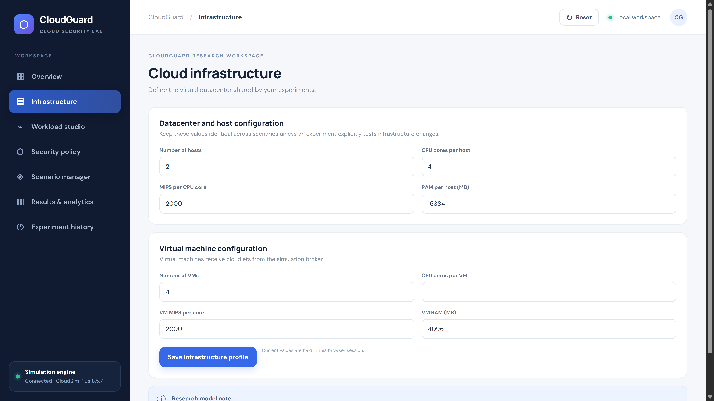
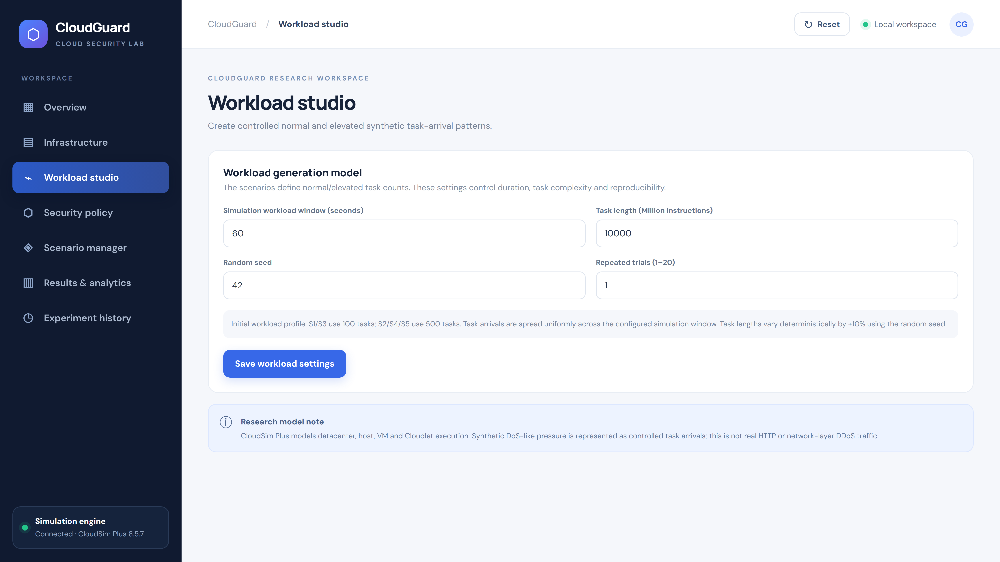
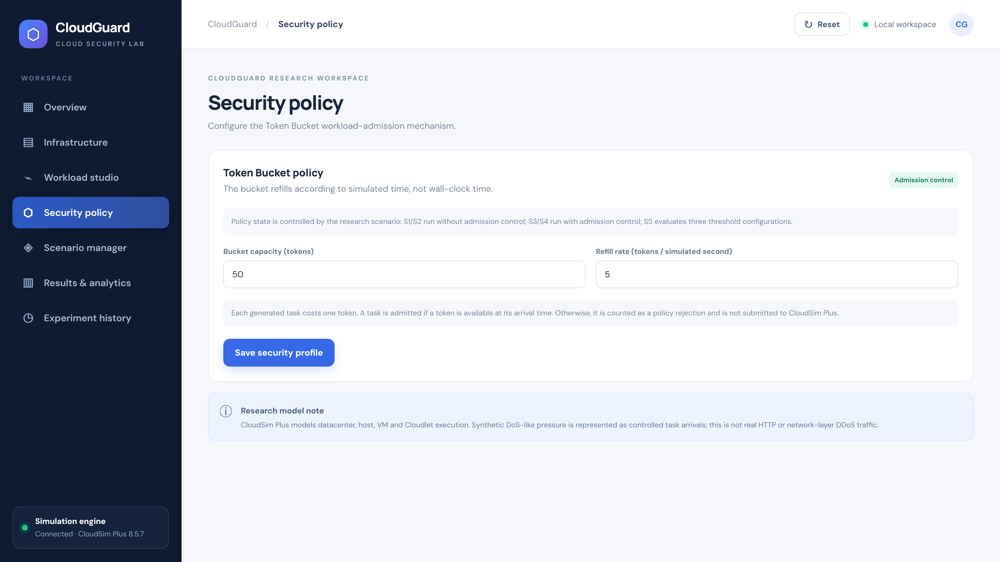

<div align="center">


# CloudGuard

### Performance Evaluation of Cloud Services Under Simulated DoS Workloads

*Shed the overload. Keep accepted work fast. Measure the trade-off — reproducibly, in simulation.*

<br/>

[](https://openjdk.org)
[](https://spring.io/projects/spring-boot)
[](https://cloudsimplus.org)
[](https://maven.apache.org)
[](https://www.h2database.com)
[](https://developer.mozilla.org)
[](#-metrics)

<br/>

<table>
<tr>
<td align="center"><b>🪣 Admission Control</b><br/>Token Bucket load shedding</td>
<td align="center"><b>☁️ CloudSim Plus</b><br/>Deterministic simulation</td>
<td align="center"><b>📊 Verified Results</b><br/>20 trials · 95% CIs</td>
<td align="center"><b>🎛️ Research Dashboard</b><br/>Scenarios · analytics · CSV</td>
</tr>
</table>

<br/>

> **Simulation, not real DoS/DDoS.** CloudGuard models computational tasks (Cloudlets) and admission control with CloudSim Plus. Completion time is simulated Cloudlet *finish − arrival* time, **not** real HTTP/network latency. Admission control **sheds workload; it does not add physical capacity.**

</div>

---

## What is CloudGuard?

CloudGuard is an **M.Tech Cyber Security** research platform that evaluates how a cloud service performs under **normal and elevated computational task-arrival pressure**, and how **Token Bucket admission control** changes that performance. The Java/Spring Boot backend drives a **CloudSim Plus** simulation; a browser dashboard runs scenarios and renders the analytics. Every result is deterministic, invariant-checked, and statistically validated.

---

## ✨ Features

| | Feature | Description |
|:---:|---|---|
| 🪣 | **Token Bucket Admission Control** | Deterministic, simulated-time load shedding, evaluated *before* the simulation starts — rejected tasks are never submitted |
| 🎛️ | **Five Research Scenarios** | S1–S5: protected vs unprotected × normal vs elevated, plus a Token Bucket threshold sweep |
| 📊 | **Verified Statistics** | 20 trials per scenario — mean, sample standard deviation (n−1) and 95% confidence intervals (Student-t) |
| 📈 | **Analytics Dashboard** | KPI cards, task-disposition donut, and protected-vs-unprotected comparison charts (SVG) |
| 🗂️ | **History & CSV Export** | Every run persisted to H2 with reopen and per-task CSV export |
| 🔬 | **Reproducible** | Deterministic by seed; counter invariants enforced; all statistics independently reproduced |

---

## 🖼️ Application Screenshots

| | |
|:---:|:---:|
|  |  |
| **Overview** — latest-run KPIs and the five scenarios | **Infrastructure** — fixed datacenter/VM baseline |
|  |  |
| **Workload Studio** — 100/500 tasks, 60 s window, seeded ±10% | **Security Policy** — Token Bucket (capacity / refill) |
|  |  |
| **Scenario Manager** — run S1–S5 | **Results & Analytics** — S4: 500 → 350 admitted, 150 rejected (30%) |
|  | |
| **Experiment History** — saved runs + CSV export | |

---

## 🏗️ System Architecture


---

## ⚙️ How It Works

```
  🖥️  Configure a scenario (infrastructure · workload · policy)
        │
  📨  POST /api/experiments/run    → request validated
        │
  🪣  Token Bucket admission (pre-pass)      ← rejected tasks are NEVER submitted
        │
  ☁️  Admitted Cloudlets run on VMs (SpaceShared → ≤ 4 concurrent)
        │
  📏  Metrics over completed tasks (completion time · makespan · throughput · 95% CI)
        │
  🗄️  Persist request + result (H2)   →   📊 SVG analytics  +  📄 CSV export
```

---

## 🧰 Tech Stack

<table>
<tr><th>Layer</th><th>Technology</th></tr>
<tr><td>☕ <b>Language / runtime</b></td><td>Java 17</td></tr>
<tr><td>🍃 <b>Backend</b></td><td>Spring Boot 3.4.5 · REST API · Bean Validation</td></tr>
<tr><td>☁️ <b>Simulation engine</b></td><td>CloudSim Plus 8.5.7 (discrete-event cloud simulation)</td></tr>
<tr><td>🗄️ <b>Persistence</b></td><td>H2 file database · JPA / Hibernate (request + result JSON)</td></tr>
<tr><td>🖥️ <b>Frontend</b></td><td>Vanilla JavaScript · HTML · CSS · SVG charts · CSV export</td></tr>
<tr><td>🧰 <b>Build / deploy</b></td><td>Maven · Docker</td></tr>
<tr><td>✅ <b>Testing</b></td><td>JUnit (18 tests: metrics + Token Bucket) · headless-Chrome UI checks</td></tr>
</table>

---

## 🧪 Simulation Scenarios

| Scenario | Workload | Tasks | Admission policy | Purpose |
|:---:|---|:---:|:---:|---|
| **S1** | Normal | 100 | Disabled | Unprotected baseline (normal load) |
| **S2** | Elevated | 500 | Disabled | Unprotected baseline (elevated load) |
| **S3** | Normal | 100 | Enabled | Admission control at normal load |
| **S4** | Elevated | 500 | Enabled | Admission control at elevated load |
| **S5** | Elevated | 500 | Enabled — 3 thresholds | Token Bucket threshold comparison |

Admission control is **scenario-driven**: S1/S2 run unprotected, S3/S4/S5 protected. S1≡S3 and S2≡S4 use identical infrastructure, workload, trials and seed — only protection differs. The request field `Security.enabled` does **not** toggle protection. S5 evaluates three **hardcoded** capacity/refill settings: `25/2`, `50/5`, `100/10`.

---

## 🪣 Token Bucket Admission Control

Protection is a **Token Bucket** admission policy, evaluated against **simulated** arrival time as a deterministic pre-pass *before* the CloudSim run:

- The bucket starts **full** (= capacity) and **refills** at a fixed rate per simulated second, up to capacity.
- Each generated task costs **one token**: admitted if a token is available at its arrival time, otherwise **rejected** and never submitted to CloudSim Plus.
- Under saturated demand: `admitted ≈ min(generated, capacity + refill × window)` — e.g. `50/5` over a 60 s window admits `min(500, 350) = 350`.

> **Admission control sheds computational workload; it does not increase physical infrastructure capacity.** Lower completion times for admitted tasks come at the cost of rejecting incoming tasks.

---

## 📊 Experimental Results

Final campaign — **20 trials per scenario** (seeds 42–61); `±` = 95% CI (Student-t, df = 19). All completion times are **simulated** Cloudlet finish − arrival time.

| Scenario | Admitted | Rejected | Rejection % | Avg completion (sim s) | Makespan (sim s) | Throughput (tasks/sim-s) |
|:---:|:---:|:---:|:---:|:---:|:---:|:---:|
| **S1 = S3** | 100 | 0 | 0 | 103.608 ± 0.429 | 258.985 | 0.3861 |
| **S2** | 500 | 0 | 0 | 611.868 ± 0.919 | 1279.555 | 0.3908 |
| **S4** | 350 | 150 | 30 | 424.215 ± 0.743 | 899.463 | 0.3891 |
| **S5 · 25/2** | 145 | 355 | 71 | 164.959 | — | 0.3835 |
| **S5 · 50/5** | 350 | 150 | 30 | 424.215 | 899.463 | 0.3891 |
| **S5 · 100/10** | 500 | 0 | 0 | 611.868 | 1279.555 | 0.3908 |

**Key findings.** Admission control is **transparent at normal load** (S1 ≡ S3, 0 rejection). Under elevated load it rejects 30% of tasks and cuts admitted-task average completion time by **~31%** (611.9 → 424.2 s) and makespan by **~30%**, while **throughput stays ≈ constant** (capacity-bound by the 4 VM processing elements). The S5 sweep shows a monotonic **rejection ↔ latency** trade-off. Lower completion times for admitted tasks come at the cost of rejecting incoming tasks — load is **shed**, capacity is **not added**.

---

## 📏 Metrics

**Task counters** (reported for the main result and each S5 variant):

- **generatedTasks** – total synthetic tasks created for the workload.
- **admittedTasks** – tasks allowed through admission control and submitted to CloudSim Plus.
- **rejectedTasks** – tasks rejected by admission control (never submitted).
- **completedTasks** – admitted Cloudlets that completed successfully.
- **unfinishedTasks** – admitted tasks neither completed nor explicitly failed (e.g. still queued when the simulation ended).
- **failedTasks** – only tasks CloudSim explicitly reported as `FAILED` / `FAILED_RESOURCE_UNAVAILABLE`.

**Invariants** (hold for the main result and every S5 variant):

```
completedTasks + unfinishedTasks + failedTasks = admittedTasks
admittedTasks  + rejectedTasks                 = generatedTasks
```

**Timing & rate metrics:** rejection % = rejected / generated × 100 · per-task completion = finish − arrival · average / P95 / maximum over completed Cloudlets · makespan = latest finish − earliest admitted arrival (0 if none complete) · throughput = completed / makespan (0-safe). Across trials: mean, sample SD (n−1), 95% CI (Student-t, df = 19). Each Cloudlet is configured with CPU 50% / RAM 5% / BW 5% utilisation **demand** (not measured output).

---

## 🔌 API

| Method | Endpoint | Description |
|---|---|---|
| `GET` | `/api/health` | Service + engine status |
| `GET` | `/api/scenarios` | Scenario catalogue (S1–S5) |
| `POST` | `/api/experiments/run` | Run one scenario (returns full result) |
| `POST` | `/api/experiments/suite` | Run the S1–S5 suite |
| `GET` | `/api/experiments` | Experiment history |
| `GET` | `/api/experiments/{id}` | One experiment result |
| `GET` | `/api/experiments/{id}/export.csv` | Per-task CSV export |

---

## 🚀 Local Development

### Prerequisites

- Java 17
- Maven (or Docker)

### 1. Clone

```bash
git clone https://github.com/akhilsabu-iiits/CloudGuard.git
cd CloudGuard
```

### 2. Run

```bash
mvn spring-boot:run            # starts the app at http://localhost:8080
# or build a jar:
mvn clean package && java -jar target/*.jar
# or with Docker:
docker compose up --build -d
```

Run the tests with `mvn test`.

| Service | URL |
|---|---|
| 🌐 Dashboard | http://localhost:8080 |
| 🔌 API | http://localhost:8080/api/health |

> For a hosted deployment, attach persistent storage at `/app/data` (the H2 file database) and set `PORT`. For multi-user production, replace H2 with a managed database and add authentication before exposing the app.

---

## 📂 Repository Structure

```text
CloudGuard/
├── README.md · pom.xml · Dockerfile · compose.yaml · .gitignore
├── src/                          # Spring Boot + CloudSim Plus app (Java) and frontend (static/)
└── docs/
    ├── images/                   # application screenshots
    ├── architecture/             # architecture diagram (SVG + PNG)
    └── RESEARCH_CONFIGURATION.md  # frozen, source-verified baseline
```

The frozen, source-verified configuration baseline is in [`docs/RESEARCH_CONFIGURATION.md`](docs/RESEARCH_CONFIGURATION.md). The full research report, experiment data, charts, presentation and viva materials are maintained separately as part of the M.Tech submission.

---

## ⚠️ Research Scope & Limitations

- **Simulation, not real DoS/DDoS.** No real HTTP, packets, or network-layer traffic; "DoS-like pressure" = sustained elevated computational task arrivals.
- **Simulated completion time** = Cloudlet finish − arrival; not real latency or availability.
- **No task loss** — every admitted Cloudlet completes; DoS impact appears as latency + rejection, not failure.
- **Deterministic uniform arrivals** (not Poisson/bursty); the seed varies task length (±10%) only, so admitted/rejected counts do not vary across trials — trials capture task-length variance only.
- **Confidence intervals, not significance** — no formal hypothesis test was run; P95/Max are reported as cross-trial means.
- **Single-node H2**, no authentication — suitable for local research, not public multi-user production.
- CPU/RAM/bandwidth figures are **configured demands**, not measured host/VM utilisation.

---

## 📄 License & Acknowledgements

CloudSim Plus is pinned to **8.5.7** and is distributed under **GPL-3.0** — review its license and include the required notices when redistributing. This repository does not yet include a top-level `LICENSE` file; add a GPL-3.0-compatible license before public redistribution.

**Acknowledgements**

- **CloudSim Plus** (Silva Filho et al., IFIP/IEEE IM 2017) and the original **CloudSim** toolkit (Calheiros et al., *Software: Practice and Experience*, 2011) — the simulation framework this project builds on.
- **Spring Boot** and the **H2 Database Engine** — application framework and persistence layer.

<div align="center">

<br/>

**M.Tech Cyber Security Research Project**
*A CloudSim Plus admission-control simulation — not real network DoS/DDoS testing.*

</div>
