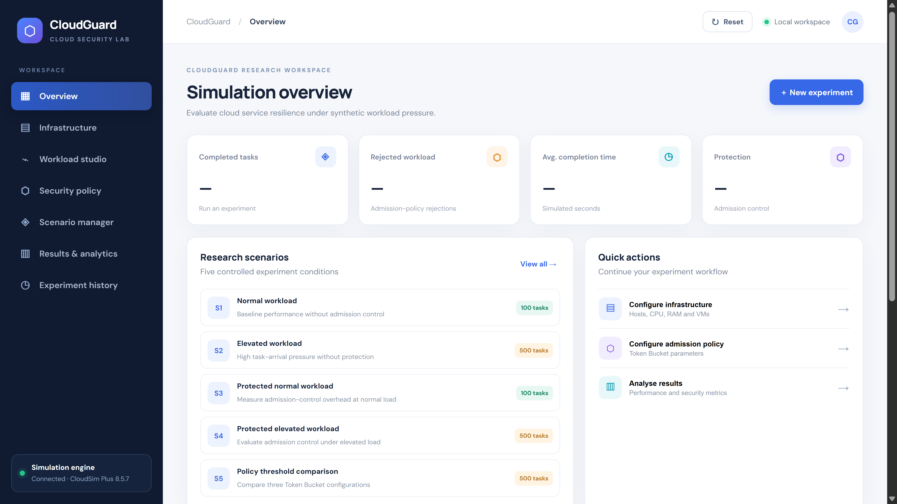
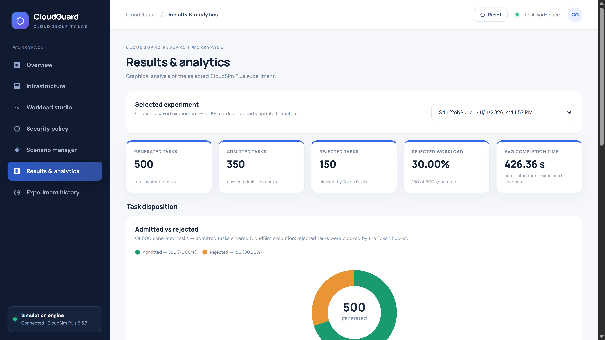
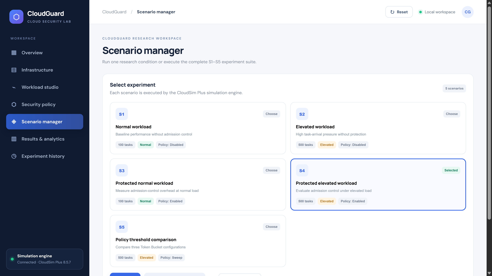
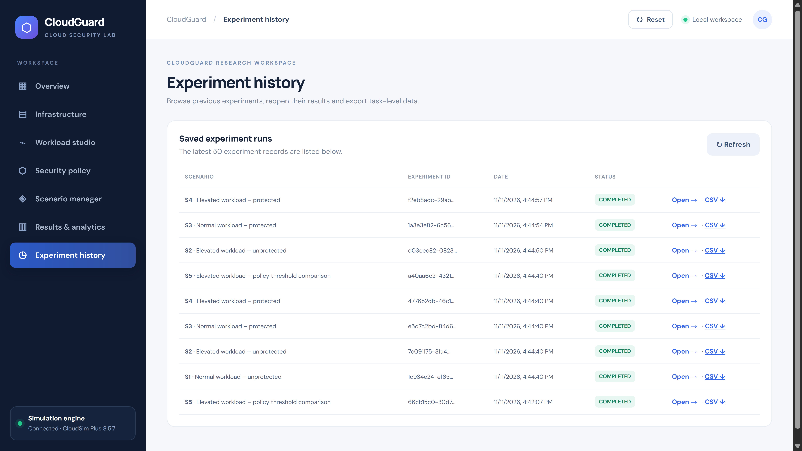
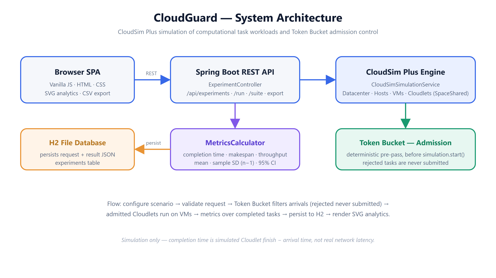

<div align="center">


# CloudGuard

### Performance Evaluation of Cloud Services Under Simulated DoS Workloads

*Shed the overload. Keep accepted work fast. Measure the trade-off — reproducibly, in simulation.*

<br/>

[](https://openjdk.org)
[](https://spring.io/projects/spring-boot)
[](https://cloudsimplus.org)
[](https://www.h2database.com)
[](https://www.docker.com)

<br/>

> **Simulation, not real DoS/DDoS.** CloudGuard models computational tasks (Cloudlets) and admission control with CloudSim Plus. Completion time is simulated Cloudlet *finish − arrival* time, **not** real HTTP/network latency. Admission control **sheds workload; it does not add physical capacity.**

</div>

---

## Overview

CloudGuard evaluates how a cloud service performs under **normal and elevated computational task-arrival pressure**, and how **Token Bucket admission control** changes that performance. A Java/Spring Boot backend drives a **CloudSim Plus** simulation; a browser dashboard runs scenarios and renders the analytics. Every result is deterministic and statistically validated over 20 trials.

---

## ✨ Features

| | Feature | Description |
|:---:|---|---|
| 🪣 | **Token Bucket admission control** | Deterministic load shedding — rejected tasks are never submitted to the simulation |
| 🧪 | **Five research scenarios** | Protected vs unprotected × normal vs elevated, plus a Token Bucket threshold sweep |
| 📊 | **Verified statistics** | 20 trials per scenario with mean and 95% confidence intervals |
| 📈 | **Analytics dashboard** | KPI cards and SVG charts, with persisted history and per-task CSV export |

---

## 🖼️ Screenshots

| | |
|:---:|:---:|
|  |  |
| **Overview** — latest-run KPIs and scenarios | **Analytics** — S4: 500 → 350 admitted, 150 rejected (30%) |
|  |  |
| **Scenario Manager** — run S1–S5 | **History** — saved runs + CSV export |

---

## ⚙️ How It Works

```
  🖥️  Configure a scenario (infrastructure · workload · policy)
        │
  🪣  Token Bucket admission (pre-pass)   ← rejected tasks are NEVER submitted
        │
  ☁️  Admitted Cloudlets run on VMs (SpaceShared → ≤ 4 concurrent)
        │
  📏  Metrics over completed tasks (completion time · makespan · throughput)
        │
  🗄️  Persist to H2   →   📊 SVG analytics  +  📄 CSV export
```



**Token Bucket:** the bucket starts full (= capacity) and refills at a fixed rate per simulated second. Each task costs one token — admitted if a token is free at its arrival time, otherwise rejected. Under saturated demand, `admitted ≈ min(generated, capacity + refill × window)`.

---

## 🧪 Scenarios

| Scenario | Workload | Tasks | Admission control | Purpose |
|:---:|---|:---:|:---:|---|
| **S1** | Normal | 100 | Off | Unprotected baseline (normal) |
| **S2** | Elevated | 500 | Off | Unprotected baseline (elevated) |
| **S3** | Normal | 100 | On | Protected at normal load |
| **S4** | Elevated | 500 | On | Protected at elevated load |
| **S5** | Elevated | 500 | On · 3 thresholds | Threshold sweep (`25/2`, `50/5`, `100/10`) |

S1≡S3 and S2≡S4 use identical infrastructure, workload, trials and seed — only protection differs.

---

## 🧰 Tech Stack

| Layer | Technology |
|---|---|
| ☕ Language | Java 17 |
| 🍃 Backend | Spring Boot 3.4.5 · REST API |
| ☁️ Simulation | CloudSim Plus 8.5.7 |
| 🗄️ Persistence | H2 file database · JPA / Hibernate |
| 🖥️ Frontend | Vanilla JS · HTML · CSS · SVG charts |
| 🧰 Build / deploy | Maven · Docker |

---

## 🚀 Getting Started

```bash
git clone https://github.com/akhilsabu-iiits/CloudGuard.git
cd CloudGuard
```

**Option A · Maven** (requires Java 17 + Maven)

```bash
mvn spring-boot:run                       # http://localhost:8080
mvn clean package && java -jar target/*.jar   # or build a jar
mvn test                                  # run the tests
```

**Option B · 🐳 Docker** (requires [Docker Desktop](https://www.docker.com/products/docker-desktop/) or [Docker Engine](https://docs.docker.com/engine/install/))

```bash
docker compose up --build -d     # build + start in the background
docker compose logs -f           # follow the logs
docker compose down              # stop (the cloudguard-data volume is kept)
```

The app serves the dashboard at **http://localhost:8080** and the API at **/api/health**. H2 data persists to the `cloudguard-data` volume (`/app/data`), so experiment history survives restarts.

---

## 🔌 API

| Method | Endpoint | Description |
|---|---|---|
| `GET` | `/api/health` | Service + engine status |
| `GET` | `/api/scenarios` | Scenario catalogue (S1–S5) |
| `POST` | `/api/experiments/run` | Run one scenario |
| `POST` | `/api/experiments/suite` | Run the S1–S5 suite |
| `GET` | `/api/experiments` | Experiment history |
| `GET` | `/api/experiments/{id}/export.csv` | Per-task CSV export |

---

## ⚠️ Scope & Limitations

- **Simulation, not real DoS/DDoS** — no real HTTP, packets, or network traffic; "DoS-like pressure" = elevated computational task arrivals.
- **Simulated completion time** = Cloudlet finish − arrival, not real latency or availability.
- **Deterministic uniform arrivals** — the seed varies task length (±10%) only, so admitted/rejected counts are stable across trials.
- **Single-node H2, no authentication** — suitable for local research, not public multi-user production.

---

## 📄 License & Acknowledgements

CloudSim Plus (8.5.7) is distributed under **GPL-3.0** — include the required notices when redistributing. Add a GPL-3.0-compatible `LICENSE` file before public redistribution.

- **CloudSim Plus** (Silva Filho et al., IFIP/IEEE IM 2017) and **CloudSim** (Calheiros et al., *Software: Practice and Experience*, 2011) — the simulation framework.
- **Spring Boot** and the **H2 Database Engine** — application framework and persistence.
